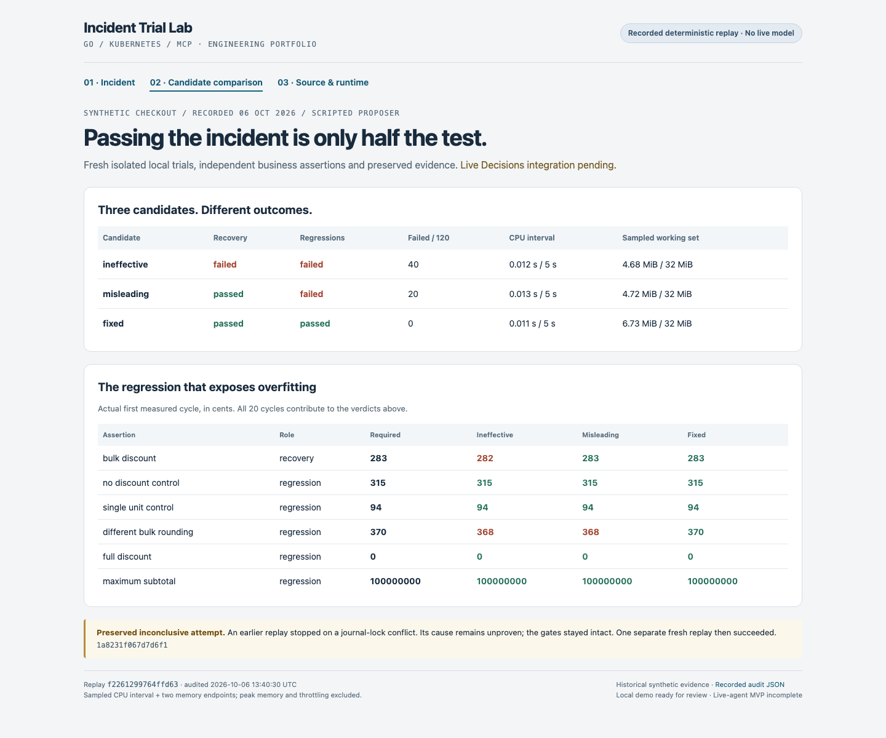

# Incident Trial Lab

Reproduce a Go service incident, compare candidate fixes in isolated Kubernetes trials, and explain the outcome with verifiable evidence.

The lab connects **Go, Kubernetes, MCP, regression testing, and source-to-runtime provenance** in one inspectable experiment. A synthetic checkout calculation returns **282¢ instead of 283¢**. Three candidate implementations demonstrate why fixing the original request is not enough: the evaluator also checks regressions, sampled resource budgets, and cleanup.

## See the result in two minutes



This is a screenshot of the committed recorded-evidence demo, not a live experiment or model-generated diagnosis.

With Go 1.26.2 available, run:

```sh
go run ./cmd/evidence-demo
```

Open `.build/demo/index.html` in a browser. The three views explain the incident, compare the candidates, and trace the result back to source, executable, image, and runtime evidence. Rendering uses committed inputs; it starts no cluster and makes no model request.

[Demo walkthrough](docs/local-evidence-demo.md) · [Screenshot captions](docs/screenshots/README.md) · [Recorded replay](docs/source-bound-runtime.md)

## Recorded results

The source-bound replay on **2026-10-06 UTC** used fresh local kind trials and a predetermined candidate sequence. Each candidate ran six workload cases over 20 measured cycles after warmup.

| Candidate | Original incident | Regression checks | Measured failures | Verdict |
| --- | --- | --- | ---: | --- |
| Ineffective | Fails | Fail | 40 | No improvement |
| Misleading | Recovers | Fail | 20 | Regression |
| Fixed | Recovers | Pass | 0 | Verified recovery within this experiment |

All three passed the predefined sampled resource gate with zero unknown observations. The initial experiment stopped inconclusively on a journal-lock conflict; that refusal is preserved alongside the later successful replay. These results describe the recorded synthetic workload, not production safety, peak memory, or a general performance improvement.

[Evidence and limits](docs/source-bound-runtime.md) · [Machine-readable replay](docs/evidence/source-bound-replay.json) · [Preserved refusal](docs/evidence/source-bound-first-refusal.json)

## Engineering decisions

- **Behavior before verdicts.** Separate recovery, regression, and budget assertions prevent a candidate from passing just by matching the failing request.
- **Fresh, owned trials.** Pinned images and manifests run in dedicated local kind clusters. A Go supervisor bounds execution, cancellation, cleanup, and crash reconciliation; the local queue supports one or two workers.
- **Evidence tied to the executed artifact.** Source and logic hashes connect to executable bytes, image identity, runtime captures, and revalidated receipts. This assumes a trusted local builder; it is not signed build attestation.
- **A typed tool boundary.** A local stdio MCP server exposes bounded operations over the same engine. It keeps evidence inspection distinct from execution authority.
- **Honest uncertainty.** Missing evidence and failed verification can produce inconclusive outcomes. The demo rejects changed or malformed evidence rather than displaying stale success.

## Explore the implementation

| Area | Code and documentation |
| --- | --- |
| Verdict evaluation | [`internal/evaluation`](internal/evaluation), [design decisions](docs/decisions.md) |
| Trials and lifecycle | [`internal/trial`](internal/trial), [`internal/lifecycle`](internal/lifecycle), [candidate walkthrough](docs/milestone-3.md) |
| Provenance | [`internal/provenance`](internal/provenance), [source/artifact binding](docs/source-artifact-binding.md) |
| MCP tools | [`internal/toolserver`](internal/toolserver), [local MCP guide](docs/local-mcp.md) |
| Recorded demo | [`internal/presentation`](internal/presentation), [`cmd/evidence-demo`](cmd/evidence-demo) |
| Offline selector evaluation | [18-case held-out evaluation](docs/heldout-evaluation.md) |

## Validation and reproduction

```sh
./scripts/check.sh
```

The check script enforces Go formatting, runs package tests with race detection and coverage, and runs `go vet`. Tests cover evaluation, provenance, lifecycle, workers, MCP boundaries, and evidence tampering. Historical run results and their scope are recorded in the linked evidence documents; coverage for one package is not coverage for the entire system.

On 2026-10-19 (America/Phoenix), a fresh source snapshot passed `./scripts/check.sh` and regenerated the recorded demo. A test fixture path was corrected to use the committed `docs/evidence` fixture; no new cluster trial or model call was needed.

For a new cluster-based experiment, follow the [baseline walkthrough](docs/walkthrough.md), [candidate comparison](docs/milestone-3.md), and [source-bound replay instructions](docs/source-bound-runtime.md). These require Docker, kind, kubectl, image builds, and disposable local resources. Hosted CI is manual-only.

## Scope

The demonstrated recovery loop is deterministic and scripted. A separate [live proposal probe](docs/live-proposal-evidence.md) records one model API wiring experiment over historical synthetic evidence; it cannot execute trials or apply changes. Autonomous diagnosis, patch generation, and a complete live-agent remediation system are future work, tracked in [MVP readiness](docs/mvp-readiness.md).

All experiments use synthetic data and dedicated local resources. No employer data or production cluster is required.
